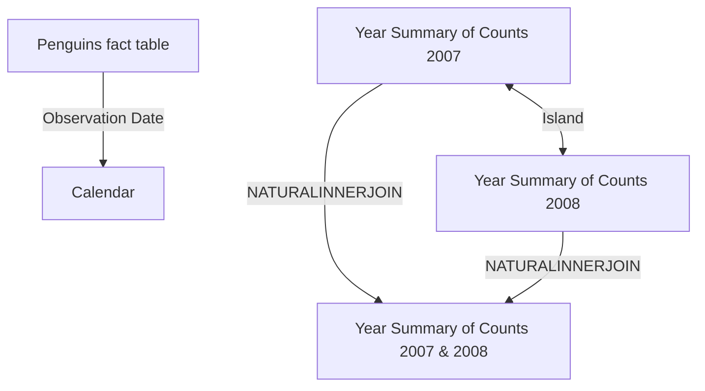

# Penguins PBIP Documentation

## Overview

This document describes the Penguins Power BI project (`Penguins.pbip`) and the semantic model packaged in the `Penguins.SemanticModel` folder. The model is built around penguin observations, island profiles, and year-over-year population trends.

- Model name: `Model`
- Report name: `Penguins`
- Primary fact table: `Penguins`
- Date table: `Calendar`
- Data source pattern: Local CSV import with DAX-generated helper tables and summary tables
- Model type: Import mode semantic model with calculated columns, calculated tables, and many KPI-style measures

## Table inventory

| Table | Hidden | Purpose |
| --- | --- | --- |
| `Penguins` | No | Main fact table with observation-level penguin records and measurement fields |
| `Calendar` | No | Date dimension used for trending and time intelligence |
| `Measure` | No | Measure library and helper table for KPI calculations |
| `Year Summary of Counts 2007` | Yes | 2007 population summary by island |
| `Year Summary of Counts 2008` | Yes | 2008 population summary by island |
| `Year Summary of Counts 2007 & 2008` | Yes | Combined yearly summary table for YoY change analysis |

## Relationship diagram



### Relationship notes

- `Penguins[Observation Date]` relates to `Calendar[Date]`.
- `Year Summary of Counts 2007[Islands]` and `Year Summary of Counts 2008[Island]` are modeled as a relationship on island name with cross filtering enabled in both directions.
- `Year Summary of Counts 2007 & 2008` is a calculated table created through `NATURALINNERJOIN` to compare island populations by year.

## Data source analysis

### Primary source: penguin observation CSV

The main data source is the local file below:

`C:\Users\bradjones\OneDrive\Documents\Power BI\Reports\Penguins\penguins_data.csv`

Power Query logic in `Penguins.tmdl` performs the following steps:

1. Reads the CSV file with `Csv.Document(File.Contents(...))`.
2. Promotes the first row to headers with `Table.PromoteHeaders`.
3. Applies explicit data types to each column, including text, integer, float, and date values.
4. Replaces missing or inconsistent gender values with `Not recorded`.
5. Normalizes values like `MALE`, `FEMALE`, and `FEMale` into consistent labels.
6. Sorts by `Individual ID` for a stable record order.

The resulting table contains fields such as:

- `studyName`
- `Sample Number`
- `Species`
- `Region`
- `Island`
- `Stage`
- `Individual ID`
- `Clutch Completion`
- `Observation Date`
- `Culmen Length (mm)`
- `Culmen Depth (mm)`
- `Flipper Length (mm)`
- `Body Mass (g)`
- `Sex`
- `Delta 15 N (o/oo)`
- `Delta 13 C (o/oo)`
- `Comments`

### Secondary source: helper table for measures

The `Measure` table is not a business source table. It is created using a compressed JSON-based empty table pattern and acts as a place to hold KPI-style measures and helper logic.

Power Query pattern:

```powerquery
let
    Source = Table.FromRows(Json.Document(Binary.Decompress(Binary.FromText("i44FAA==", BinaryEncoding.Base64), Compression.Deflate)), let _t = ((type nullable text) meta [Serialized.Text = true]) in type table [Column1 = _t]),
    #"Changed Type" = Table.TransformColumnTypes(Source,{{"Column1", type text}}),
    #"Removed Columns" = Table.RemoveColumns(#"Changed Type",{"Column1"})
in
    #"Removed Columns"
```

### DAX-generated tables

- `Calendar` is created with `CALENDARAUTO()` to generate a date dimension for trend analysis.
- `Year Summary of Counts 2007` uses `SUMMARIZE` + `FILTER` to calculate population by island for 2007.
- `Year Summary of Counts 2008` does the same for 2008.
- `Year Summary of Counts 2007 & 2008` uses `NATURALINNERJOIN` to align annual island counts and create the `YoY change in PoP between 07-08` column.

## Row-level filters and security

No row-level security (RLS) roles, role membership rules, or table-level filter expressions were found in the model definition files. There are no `security` sections, no user roles, and no `Table.FilterRows` logic in the semantic model metadata. Therefore, this model currently has no row-level filters applied.

## Measure catalog

The model includes many DAX measures that support business insights around population trends, sex distribution, island comparisons, time intelligence, and summary statistics. The business-friendly descriptions below summarize each measure.

### Population and record counts

#### Largest Species Pop in 2009 (Sample Number)
Business meaning: Identifies which penguin species had the highest observed population in 2009 and returns the name with its count.

```DAX
VAR SUM1 =
    FILTER(
        SUMMARIZE('Penguins',[Species], [Observation Date], "Pop SUM1", SUM('Penguins'[Sample Number])),
        YEAR([Observation Date]) = 2009
    )
VAR SUM2 = SUMMARIZE(SUM1,[Species], "Pop SUM2", [SUM of Sample Number])
VAR TOPN1 = TOPN(1, SUM2, [Pop SUM2], DESC)
VAR Final = SELECTCOLUMNS(TOPN1, "Species", [Species] & UNICHAR(10) & FORMAT([Pop SUM2], "#,0"))
RETURN Final
```

#### COUNT IDs
Business meaning: Counts the total number of penguin records in the current filter context.

```DAX
COUNT(Penguins[Individual ID])
```

#### Penguine Pop in 2007
Business meaning: Returns the penguin population for the year 2007 using prior-year comparison logic.

```DAX
CALCULATE(
    [COUNT IDs],
    SAMEPERIODLASTYEAR('Calendar'[Date]),
    KEEPFILTERS('Calendar'[Year] = 2007)
)
```

#### Island with greatest YoY change in PoP between 07-08 table
Business meaning: Finds the island with the largest population change between 2007 and 2008 in the summary table.

```DAX
IF(
    [Penguine Pop in 2007] = BLANK(),
    BLANK(),
    [COUNT IDs] - [Penguine Pop in 2007]
)
```

#### Island with greatest YoY change in PoP between 07-08 card
Business meaning: Presents the island name and change magnitude for the biggest population shift between 2007 and 2008.

```DAX
CONCATENATEX(
    TOPN(1,
        'Year Summary of Counts 2007 & 2008',
        [YoY change in PoP between 07-08],
        DESC
    ),
    [Island] & UNICHAR(10) & FORMAT([YoY change in PoP between 07-08], "#,0")
)
```

#### % of penguins that live on Dream island
Business meaning: Shows the share of all penguins that live on Dream Island.

```DAX
DIVIDE(CALCULATE([SUM of Sample Number], FILTER('Penguins',Penguins[Island] = "Dream")), [SUM of Sample Number])
```

### Gender profile and island composition

#### COUNT Sex (M)
Business meaning: Counts male penguins.

```DAX
CALCULATE(COUNT('Penguins'[Sex]), FILTER('Penguins',[Sex] = "MALE"))
```

#### COUNT Sex per Island
Business meaning: Counts all male and female observations within each island context.

```DAX
CALCULATE(
    [COUNT IDs],
    ALLEXCEPT(Penguins,Penguins[Island]),
    FILTER('Penguins','Penguins'[Sex] IN {"MALE", "FEMALE"})
)
```

#### % of Sex (M) per Island
Business meaning: Shows the proportion of male penguins within the current island context.

```DAX
DIVIDE([COUNT Sex (M)], [COUNT Sex per Island])
```

#### COUNT Sex (F)
Business meaning: Counts female penguins.

```DAX
CALCULATE(COUNT('Penguins'[Sex]), FILTER('Penguins',[Sex] = "FEMALE"))
```

#### % of Sex (F) per Island
Business meaning: Shows the proportion of female penguins within the current island context.

```DAX
DIVIDE([COUNT Sex (F)], [COUNT Sex per Island])
```

#### Island with most unbalanced M/F ratio amoung penguins
Business meaning: Identifies the island where the male/female share is most imbalanced.

```DAX
ABS([% of Sex (M) per Island] - [% of Sex (F) per Island])
```

#### Which Island with most unbalanced M/F ratio amount penguins
Business meaning: Returns the island name and percentage spread for the most imbalanced gender mix.

```DAX
CONCATENATEX(
    TOPN(1,
        SUMMARIZE('Penguins', [Island], "Ratios", [Island with most unbalanced M/F ratio amoung penguins (Sample Number)]),
        [Ratios],
        DESC
    ),
    [Island] & UNICHAR(10) & FORMAT([Island with most unbalanced M/F ratio amoung penguins (Sample Number)], "Percent")
)
```

### Time-based trend and cumulative measures

#### Cumulative COUNT
Business meaning: Displays running total observations from the start of the selected date range to the current date.

```DAX
CALCULATE(
    [COUNT IDs],
    FILTER(ALLSELECTED('Calendar'), 'Calendar'[Date] <= MAX('Calendar'[Date]))
)
```

#### Total COUNT Last Y
Business meaning: Shows the observation count from the same period one year earlier.

```DAX
CALCULATE(
    [COUNT IDs],
    DATEADD('Calendar'[Date], -1, YEAR)
)
```

#### Cumulative COUNT Last Y
Business meaning: Shows cumulative year-ago counts for period-over-period comparisons.

```DAX
CALCULATE(
    [Total COUNT Last Y],
    FILTER(ALLSELECTED('Calendar'), 'Calendar'[Date] <= MAX('Calendar'[Date]))
)
```

#### Cumulative Growth Difference (Current - Last Y)
Business meaning: Measures the gap between current cumulative volume and previous-year cumulative volume.

```DAX
[Cumulative COUNT] - [Cumulative COUNT Last Y]
```

#### Cumulative SUM (Sample Number)
Business meaning: Provides a running total sample count over time.

```DAX
CALCULATE(
    [SUM of Sample Number],
    FILTER(ALLSELECTED('Calendar'), 'Calendar'[Date] <= MAX('Calendar'[Date]))
)
```

#### Total SUM Last Y (Sample Number)
Business meaning: Returns the total sample number from the same period last year.

```DAX
CALCULATE(
    [SUM of Sample Number],
    DATEADD('Calendar'[Date], -1, YEAR)
)
```

#### Cumulative SUM Last Y (Sample Number)
Business meaning: Produces a cumulative year-ago total for trend comparison.

```DAX
CALCULATE(
    [Total SUM Last Y (Sample Number)],
    FILTER(ALLSELECTED('Calendar'), 'Calendar'[Date] <= MAX('Calendar'[Date]))
)
```

#### Cumulative Growth Difference (Current - Last Y) (Sample Number)
Business meaning: Highlights the delta between current cumulative population and the equivalent prior-year period.

```DAX
[Cumulative SUM (Sample Number)] - [Cumulative SUM Last Y (Sample Number)]
```

### Body measurement and morphology summaries

#### AVG Body Mass(g)
Business meaning: Returns the average body mass of penguins in the active filter context.

```DAX
IF(
    AVERAGE('Penguins'[Body Mass (g)]) <> BLANK(),
    AVERAGE('Penguins'[Body Mass (g)]),
    0
)
```

#### AVG Culmen Length(mm)
Business meaning: Returns the average culmen length in millimeters.

```DAX
IF(
    AVERAGE('Penguins'[Culmen Length (mm)]) <> BLANK(),
    AVERAGE('Penguins'[Culmen Length (mm)]),
    0
)
```

#### AVG Culmen Depth(mm)
Business meaning: Returns the average culmen depth in millimeters.

```DAX
IF(
    AVERAGE('Penguins'[Culmen Depth (mm)]) <> BLANK(),
    AVERAGE('Penguins'[Culmen Depth (mm)]),
    0
)
```

#### MIN Body Mass(g)
Business meaning: Shows the lightest recorded body mass in the filter context.

```DAX
MIN('Penguins'[Body Mass (g)])
```

#### MAX Body Mass(g)
Business meaning: Shows the heaviest recorded body mass in the filter context.

```DAX
MAX('Penguins'[Body Mass (g)])
```

#### AVG & MIN & MAX Body Mass(g)
Business meaning: Combines average, minimum, and maximum body mass into one formatted summary string.

```DAX
FORMAT([AVG Body Mass(g)], "#,0") & " | " & FORMAT([MIN Body Mass(g)], "#,0") & " | " & FORMAT([MAX Body Mass(g)], "#,0")
```

#### MAX Flipper Length(mm)
Business meaning: Identifies the longest flipper length recorded.

```DAX
MAX('Penguins'[Flipper Length (mm)])
```

#### MIN Flipper Length(mm)
Business meaning: Identifies the shortest flipper length recorded.

```DAX
MIN('Penguins'[Flipper Length (mm)])
```

#### AVG | MIN | MAX Flipper Length
Business meaning: Combines average, minimum, and maximum flipper lengths into one text summary.

```DAX
IF(FORMAT([AVG Flipper Length(mm)], "#,0") = "0", BLANK(), FORMAT([AVG Flipper Length(mm)], "#,0")) & " | " & FORMAT([MIN Flipper Length(mm)], "#,0") & " | " & FORMAT([MAX Flipper Length(mm)], "#,0")
```

#### AVG Flipper Length(mm)
Business meaning: Returns the average flipper length in millimeters.

```DAX
AVERAGE('Penguins'[Flipper Length (mm)])
```

#### AVG & MIN & MAX Body Mass(g) (Sample Number)
Business meaning: Provides a formatted body-mass summary using sample counts as the measurement basis.

```DAX
IF(FORMAT([AVG Body Mass(g)], "#,0") = "0", BLANK(), FORMAT([AVG Body Mass(g)], "#,0")) & " | " & FORMAT([MIN Body Mass(g)], "#,0") & " | " & FORMAT([MAX Body Mass(g)], "#,0")
```

### Share-of-total and distribution measures

#### SUM of Sample Number
Business meaning: Totals the sample number field for the current filter context.

```DAX
IF(SUM('Penguins'[Sample Number]) <> BLANK(),SUM('Penguins'[Sample Number]),0)
```

#### SUM of Sample Number Sex (M)
Business meaning: Totals the sample count for male penguins only.

```DAX
IF(
    CALCULATE([SUM of Sample Number], FILTER('Penguins',[Sex] = "MALE")) <> BLANK(),
    CALCULATE([SUM of Sample Number], FILTER('Penguins',[Sex] = "MALE")),
    0
)
```

#### SUM of Sample Number Sex (F)
Business meaning: Totals the sample count for female penguins only.

```DAX
IF(
    CALCULATE([SUM of Sample Number], FILTER('Penguins',[Sex] = "FEMALE")) <> BLANK(),
    CALCULATE([SUM of Sample Number], FILTER('Penguins',[Sex] = "FEMALE")),
    0
)
```

#### SUM Sex per Island
Business meaning: Totals male and female observations within an island context.

```DAX
CALCULATE(
    [SUM of Sample Number],
    ALLEXCEPT(Penguins,Penguins[Island]),
    FILTER('Penguins','Penguins'[Sex] IN {"MALE", "FEMALE"})
)
```

#### % of Sex (M) per Island (Sample Number)
Business meaning: Shows the male share of each island’s population using sample counts.

```DAX
IF(
    DIVIDE([SUM of Sample Number Sex (M)], [SUM Sex per Island]) <> BLANK(),
    DIVIDE([SUM of Sample Number Sex (M)], [SUM Sex per Island]),
    0
)
```

#### % of Sex (F) per Island (Sample Number)
Business meaning: Shows the female share of each island’s population using sample counts.

```DAX
IF(
    DIVIDE([SUM of Sample Number Sex (F)], [SUM Sex per Island]) <> BLANK(),
    DIVIDE([SUM of Sample Number Sex (F)], [SUM Sex per Island]),
    0
)
```

#### % of Penguins per Island ALL
Business meaning: Returns the denominator or total count needed for island share calculations.

```DAX
CALCULATE([COUNT IDs], ALL(Penguins[Island]))
```

#### % of Penguins per Island
Business meaning: Shows each island’s share of all penguin observations.

```DAX
DIVIDE([COUNT IDs], [% of Penguins per Island ALL],0)
```

#### % of Penguins per Island (Sample Number)
Business meaning: Shows each island’s share of the total penguin population using sample count totals.

```DAX
DIVIDE([SUM of Sample Number], [% of Penguins per Island ALL (Sample Number)],0)
```

#### % of Penguins per Island ALL (Sample Number)
Business meaning: Returns the sample-count total used as the denominator for island share calculations.

```DAX
CALCULATE([SUM of Sample Number], ALL(Penguins[Island]))
```

#### SUM of Sample Number (% of ALL)
Business meaning: Displays each category’s contribution to the total population as a percentage of the full dataset.

```DAX
DIVIDE([SUM of Sample Number], CALCULATE([SUM of Sample Number], ALL(Penguins[Island])))
```

#### Island with most unbalanced M/F ratio amoung penguins (Sample Number)
Business meaning: Detects the island with the largest male/female ratio imbalance based on sample counts.

```DAX
ABS([% of Sex (M) per Island (Sample Number)] - [% of Sex (F) per Island (Sample Number)])
```

### Formatting, helper, display, and miscellaneous measures

#### Bogus Refresh Time
Business meaning: Demonstrates the current timestamp and is used as a dynamic display measure rather than a core business KPI.

```DAX
NOW()
```

#### Clutch Completion Count
Business meaning: Counts the number of clutch completion records in the dataset.

```DAX
COUNT(Penguins[Clutch Completion])
```

#### Island Conditional Formatting
Business meaning: Returns a color code for island-specific conditional formatting in visuals.

```DAX
SWITCH(
    TRUE(),
    Search("*Dream*", MAX('Penguins'[Island]),,BLANK()) > 0, "#41a4ff",
    Search("*Torgersen*", MAX('Penguins'[Island]),,BLANK()) > 0, "#e1f1c6",
    Search("*Biscoe*", MAX('Penguins'[Island]),,BLANK()) > 0, "#8790CE"
)
```

## Key findings from the model

- The model is structured around a single core fact table and a strong date dimension.
- The most important business analytics focus on island-level distribution, sex balance, measurement distributions, and year-over-year trend changes.
- The model includes several useful helper measures and summary tables, but no security-layer logic or row-level filters.
- The Year Summary tables are tailored to compare island population changes between 2007 and 2008 and support top-island analyses.

## Final summary

This PBIP is a well-structured exploratory model for understanding penguin populations and morphology across islands and time. It is built primarily from a cleaned local CSV dataset and enhanced with DAX-driven time intelligence, summary tables, and comparison measures that support dashboards and report visuals. The semantic model is analytics-focused and does not currently include row-level security or other data access restrictions.
